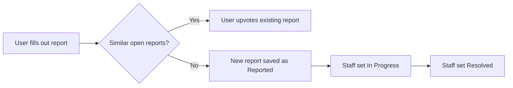

# CampusFix

CampusFix is a campus maintenance reporting app built for the LION Code Challenge 2026 at Penn State Abington. Students, faculty and staff can report broken lights, leaks, jammed doors and other facility issues, see if someone already reported it, and follow the issue until it is fixed.

## Team members
Chelsie Banton, Xiomara Mohamed, Zainab Afridi 

## Features built
Core features
1. Report an issue with a title, description, category and campus location
2. Attach a photo to a report
3. Browse and search reports by category, location, status or keyword
4. Track status through Reported, In Progress and Resolved, with a history of every change
5. Duplicate handling: before a report is submitted the app shows similar open reports and lets the user upvote one instead of creating a new one

Stretch features
1. Smarter duplicate detection that combines text similarity with matching location and category
2. Facilities staff view that ranks open reports by upvotes and lets staff update the status and leave a note
3. Dashboard showing total, open and resolved reports plus the most reported buildings and categories
4. Category suggestion based on keywords in the title and description

## How to run the app
1. Install Python 3.10 or newer
2. Install the requirements with `pip install -r requirements.txt`
3. Start the app with `streamlit run app.py`
4. Open the link Streamlit prints, usually http://localhost:8501

The app creates a local SQLite database called campusfix.db with made up sample reports the first time it runs. Delete that file to start fresh.

## How it works

Data model
1. reports: id, title, description, category, location, photo, status, upvotes, created, updated
2. history: id, report_id, status, note, changed

## Tools and technologies
Python, Streamlit, SQLite, Pandas, and difflib for text similarity

## AI use
AI tools were used to help plan and write parts of the code. All code was reviewed, run and tested by the team.

## Limitations and next steps
Duplicate detection uses text similarity and does not compare photos yet. There are no accounts, so the staff page is open to anyone. Next steps would be logins for staff, notifications when a report changes status, and a campus map of reports.

All data in this app is sample or made up data. It does not connect to any real Penn State systems.

## Live app
Runs locally, see How to run the app above.
